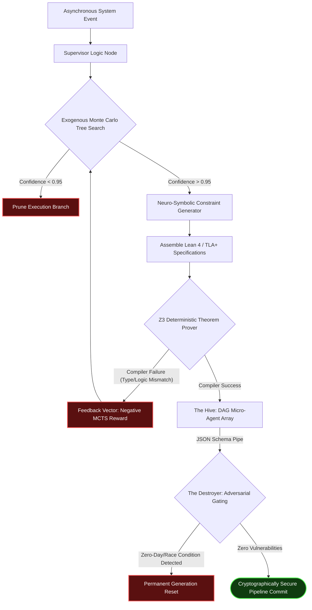

> **STATUS: ASPIRATIONAL DESIGN DOC — not an accurate description of the code.**
> This file describes the *original vision*. Metrics like "10⁶ node evaluations"
> and "64–256 Kubernetes pods" were never implemented and are not real numbers.
> For what the code actually does, see `README.md` and the `apex/` package.
# TECHNICAL SPECIFICATION: APEX V-6.0 KERNEL

> **Design Authority**: RAMLI.T.MICHAEL
> **Type**: Open-Weights Architectural Paradigm
> **Focus**: Deterministic AI Orchestration via MCTS & Theorem Proving

---

## I. SYSTEM TOPOLOGY DIAGRAM

The APEX V-6.0 Asymmetric Execution Pipeline completely isolates the base LLM context from final production commit. The structural flow enforces deterministic constraint parsing before any logic generation occurs.

---

## II. EXOGENOUS MONTE CARLO TREE SEARCH (MCTS)

### Problem Definition
Modern LLMs operating synchronously rely on sequential $\mathcal{O}(N)$ token probability. This guarantees hallucination degradation across long horizons.

### The APEX Alpha-Routing Algorithm
V-6.0 wraps the primary generator node inside an external MCTS loop (typically deployed via Kubernetes stateless pods). The LLM is strictly utilized to compute the Value function $V(s)$ and Policy prior probability $P(a|s)$.

1. **Selection**: Traverse the logic tree from root to leaf via Upper Confidence Bounds (UCB1):
   $$ U(s, a) = Q(s, a) + c_{puct} \cdot P(a|s) \cdot \frac{\sqrt{N(s)}}{1 + N(s, a)} $$
2. **Expansion**: The LLM predicts multiple subsequent execution logical nodes.
3. **Evaluation**: Nodes are heuristically scored based on topological viability, NOT grammatical correctness.
4. **Backpropagation**: Rewards update all ancestral node values. Branches falling below the $95\%$ confidence limit ($c_{puct}$ thresholding) are unilaterally pruned.

---

## III. NEURO-SYMBOLIC COMPILATION

A core failure vector of frontier AI is allowing deep-learning models to write critical execution code directly. Mathematical algorithms (like token predictors) cannot inherently guarantee absolute logical invariants.

**The Z3 Funnel**:
- The MCTS output is constrained to formulate mathematical specifications (e.g., `TLA+` state machines or `Lean 4` algebraic geometries).
- These specs are piped instantaneously to a Z3 SMT solver.
- If the Z3 compiler throws a logic exception, the probabilistic node is destroyed. The LLM cannot hallucinate a pass; it must satisfy the deterministic compilation lock.

---

## IV. DAG HIVE AND THE DESTROYER GATE

### The O(N²) Attention Collapse
Transformers experience exponential context degradation ($O(N^2)$). Mythos relies on 10+ Trillion parameters to overcome this internally. V-6.0 offloads it externally.

We establish the **HIVE**: A scalable Directed Acyclic Graph (DAG) of heavily-quantized, high-speed micro-agents (e.g., Gemini Flash). State is strictly routed across explicit JSON pipes. Memory is distributed physically, theoretically unbounding context length completely.

### Adversarial "Destroyer" Gate
Prior to any continuous deployment (CD) commit, the aggregated execution file is pushed to an isolated, context-blind node ("The Destroyer").
- **System Prompt**: *"Attack this architecture. Find Byzantine faults, race conditions, or access-control bypasses. Do not optimize. Only destroy."*
- If the Destroyer returns valid exploitation paths, the original MCTS branch is marked corrupted and reset entirely. This structurally immunizes the APEX framework against the cyber-reasoning methodologies traditionally required of ultra-dense models.
