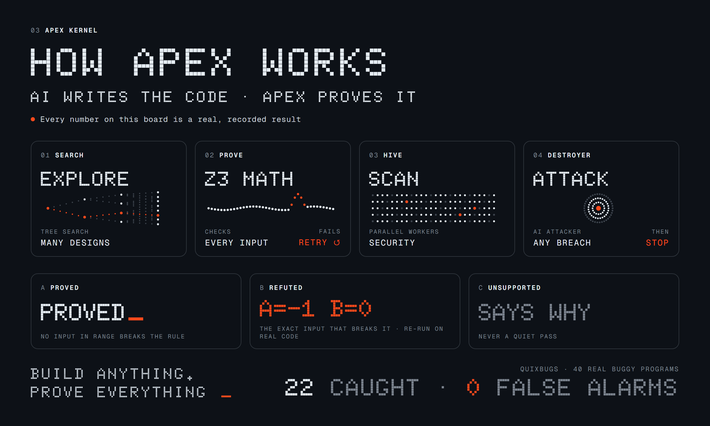

# APEX Kernel

**AI writes the code. APEX proves it, or shows exactly where it breaks.**



APEX is a verification layer for code written by AI models (or by people).
You give it a function and the rule it must keep. APEX does not *trust* the
answer. It checks it with a math solver (Z3), a security scan and an AI
attacker. Any one of them can stop the pipeline.

**Author:** Ramli T. Michael · THE AO · **License:** MIT

---

## Three answers, never a guess

| APEX says | What it means |
|---|---|
| **PROVED** | No input in the stated range breaks the rule. |
| **REFUTED** | Here is the exact input that breaks it. APEX re-runs the real code on it to confirm. |
| **UNSUPPORTED** | APEX cannot model this code yet, and it says exactly why. It never quietly passes it. |

```bash
python -m apex --verify-code examples/buggy_max.py \
  --postcondition "result >= a and result >= b"
# -> REFUTED: counterexample {'a': -1, 'b': 0, 'result': -1}
```
The function claimed to return the larger number. APEX found the input where
it does not.

---

## How it works

| # | Stage | What it does | File |
|---|---|---|---|
| 01 | **SEARCH** | Monte Carlo tree search over design options, scored by the model, bounded by node, call and time budgets. | `apex/layer1_mcts.py` |
| 02 | **PROVE** | The model writes the *negation* of a safety property; Z3 decides it. `unsat` = proved, `sat` = concrete counterexample, malformed input = rejected. A rejected design goes back to SEARCH, and the next-best one is tried. | `apex/layer2_z3.py` |
| 03 | **HIVE** | Splits the target into shards and runs the `bandit` security analyzer on each in parallel. Fails on high-severity findings or a crashed worker. | `apex/layer3_hive.py` |
| 04 | **DESTROYER** | An isolated AI attacker reviews the result. The code it reviews is quarantined as inert data, so it cannot inject instructions. A breach, malformed output or timeout fails the gate. | `apex/layer4_gate.py` |

`apex/orchestrator.py` runs 01 → 04 in order and returns a structured result
with per-stage metrics.

### Extra modes
- **Prove real Python** (`apex/pyverify.py`, `apex/pybounded.py`): turns a
  Python function into Z3 and proves a postcondition, or returns failing
  inputs. Loops, calls, int lists and strings are handled up to a bound.
- **Spec repair** (`--cegis`, `apex/cegis.py`): when Z3 rejects a spec the
  model wrote, the counterexample is sent back and the model must repair it,
  up to a round limit.
- **Several attackers** (`--adversaries N`): N attackers at different
  temperatures. Any one breach fails the gate.

---

## Proof: QuixBugs benchmark

[QuixBugs](https://github.com/jkoppel/QuixBugs) is a public set of 40 small
Python programs, each with a buggy and a correct version. No LLM is used and
no API key is needed.

| step | caught | missed | false_alarm | unsupported |
|---|---:|---:|---:|---:|
<!-- BENCH-TABLE -->
| baseline: original `verify_function` | 0 | 0 | 0 | 40 |
| (a) + bounded loops | 1 | 0 | 0 | 39 |
| (b) + inlined calls | 2 | 0 | 0 | 38 |
| (c) + int lists / str | 22 | 0 | 0 | 18 |
| (d) bounded equivalence | 20 | 0 | 0 | 20 |
<!-- /BENCH-TABLE -->

- **caught** = the buggy version is refuted, a real run of the buggy file on
  that input confirms the bug, and the correct version is proved up to the
  bound.
- **false_alarm** = the correct version was refuted. It is **0 at every step**.
- **unsupported** is never counted as caught, and always lists the reason.
- **(d) equivalence** needs no spec at all: it compares the buggy and correct
  files and finds an input where they behave differently.

Per-program results, the bound used for each one and every reason are in
[`bench/REPORT.md`](bench/REPORT.md).

```bash
python -m bench.run --step baseline   # then: loops, calls, lists, equiv
python -m bench.report                # rebuilds bench/REPORT.md (~40 min on 4 cores)
```

---

## Quickstart

```bash
pip install -r requirements.txt

python -m apex --offline --demo          # offline demo, no API key; should PASS
python -m examples.deadlock_check        # Z3 proving and refuting deadlock-freedom

python -m apex --offline \
  --spec "(declare-const x Int)(assert (> x 0))(assert (< x 0))(check-sat)" \
  --target tests/fixtures/vulnerable     # stops at HIVE on the vulnerable fixture
```
For live model calls (SEARCH, PROVE, DESTROYER), copy `.env.example` to
`.env`, add `GEMINI_API_KEY`, and drop `--offline`.

```bash
python -m pytest -q   # full suite, offline, zero API calls (deterministic mock LLM)
```

---

## What "proved" means, and what APEX does not do

- **Proved up to a bound.** Loops are unrolled up to K rounds, and lists and
  strings have a maximum length. String inputs are printable ASCII (character
  codes 32–126). An input that needs more than K rounds is reported, never
  silently dropped. A proof does not cover inputs larger than the bound.
- **APEX proves the rule you give it.** If the rule is wrong or too weak, a
  bug can still pass. A human should review *which* rules matter. That is the
  hard part of all verification, and APEX makes it visible rather than hiding it.
- APEX does not make code "unhackable" in general. It proves specific,
  readable properties and runs real security checks.

---

## Repository layout

```
apex/
  orchestrator.py   pipeline wiring, metrics, structured result
  layer1_mcts.py    01 SEARCH: MCTS + validation-guided re-selection
  layer2_z3.py      02 PROVE: Z3 verification
  layer3_hive.py    03 HIVE: parallel bandit scan
  layer4_gate.py    04 DESTROYER: adversarial gate, injection hardening, consensus
  pyverify.py       Python function -> Z3
  pybounded.py      bounded loops / calls / lists + bounded equivalence
  cegis.py          counterexample-guided spec repair
  llm_client.py     shared LLM client, strict parsers, offline mock
  __main__.py       CLI (python -m apex)
bench/              QuixBugs benchmark: specs, runner, results, REPORT.md
examples/           deadlock_check.py, buggy_max.py
tests/              offline test suite + fixtures
docs/               images
```

**History.** APEX began as the V6 design in `ARCHITECTURE.md` and
`APEX_V6_FORMAL_KERNEL.md`. This repository is the working build of that
design. Those two files describe the original vision, not the current code.

## Citation
```
Ramli T. Michael. APEX Kernel: AI writes the code, APEX proves it. THE AO, 2026.
https://github.com/ramlimicheal/APEX-V6-KERNEL
```
